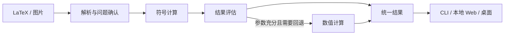
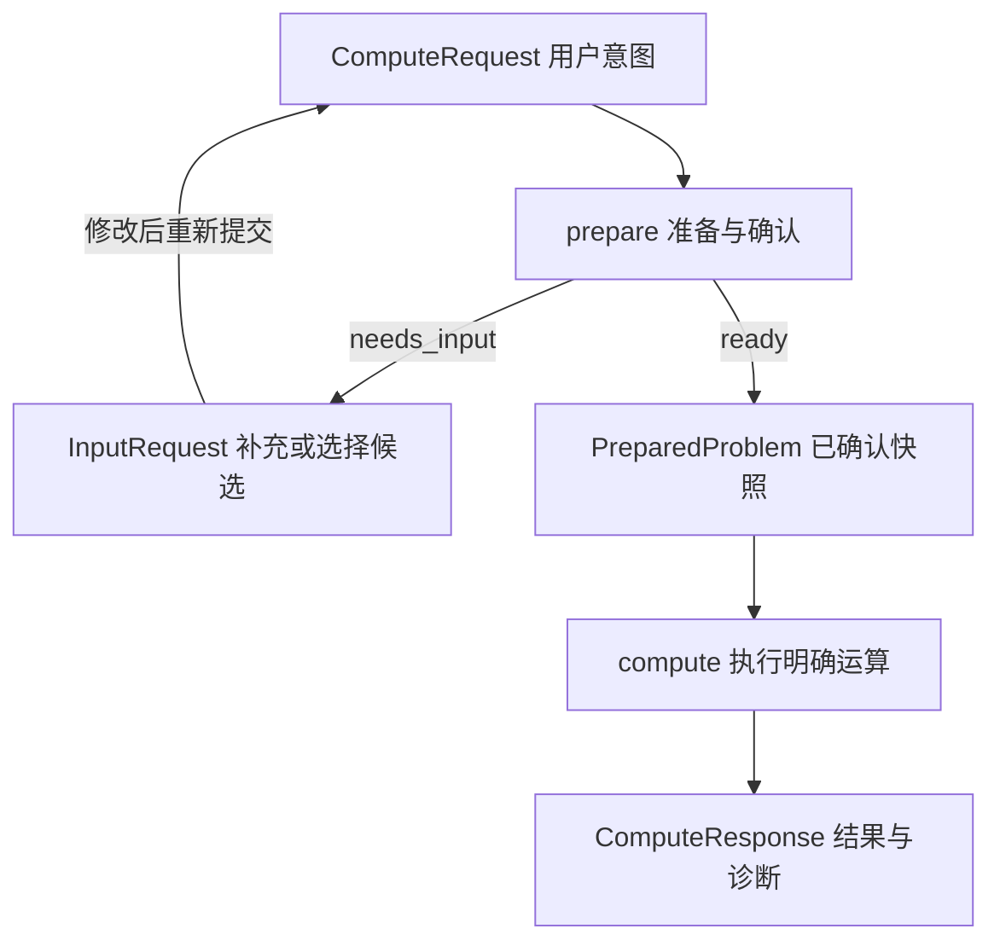

# 项目架构

MathLens 按职责划分 Python 模块与包，共用一条计算链路。模块不必对应独立服务、进程或抽象基类。



## 目录与当前状态

目前已有数据模型与公开函数签名，尚无计算、OCR、JSON codec、进程调度或界面
实现。下列目录按职责划分，不要求每个模块独立运行。

```text
src/mathlens/
├── __init__.py
├── enums.py                 枚举：运算、状态、定义域等
├── schemas/                 公开数据模型，按类型分组
│   ├── __init__.py          统一导出，保留 mathlens.schemas 导入方式
│   ├── base.py              数学表示、JSON 类型、版本常量
│   ├── inputs.py            公式输入、图片区域与资源
│   ├── operations.py        运算规格及专属参数
│   ├── requests.py          符号假设、请求偏好、请求与问题快照
│   ├── diagnostics.py       诊断、补充项与确认候选
│   ├── preparation.py       准备响应
│   ├── recognition.py       OCR 请求、候选和响应
│   ├── results.py           数学答案、条件、近似、步骤和计算响应
│   └── tasks.py             预算、能力、worker 协议与后台任务
├── application.py           准备、计算、一站式调用
├── execution.py             worker 执行、取消和进度接口
├── jobs.py                  后台任务提交、查询和取消
├── codec.py                 JSON 编解码与边界校验接口
├── media.py                 图片资源管理接口
├── cli.py                   命令行入口
├── ocr/
│   └── __init__.py          图片公式识别接口
├── parsing/
│   ├── normalize.py         预留：公式格式清理
│   └── latex.py             预留：LaTeX 解析
├── solving/
│   ├── symbolic.py          预留：符号计算
│   └── serialization.py     预留：数学对象转公开结果
└── rendering/
    └── formats.py           文本、LaTeX、JSON 展示接口
```

`parsing/` 和 `solving/` 中的算法文件仍为空；Web、桌面、数值后端和步骤生成器
尚未建立实现模块。模型覆盖未来功能，不表示这些功能已可调用。

## 职责与依赖

| 职责 | 内容 | 边界 |
|---|---|---|
| 输入与解析 | OCR 候选、LaTeX 转换、运算意图与参数校验、预览 | 保留原始输入；歧义需要修正或确认 |
| 应用编排 | 准备问题、调用计算、决定回退、控制执行预算 | 入口共用此流程，不各写一套求解逻辑 |
| 计算 | 符号/数值计算、结果分类、校验、步骤与数学内容转换 | 不读用户文件、不调用 OCR、不操作界面 |
| 展示 | 输入编辑、确认、格式选择与排版 | 只展示公开结果，不补算答案或步骤 |
| 共享模型 | 请求、问题描述、结果与诊断 | 可序列化，不依赖第三方数学对象或界面 |

入口调用应用层，应用层组合解析、计算与执行能力；这些模块依赖共享模型，不反向依赖入口。第三方库的对象和调用规则封装在解析、计算内部。

共享模型内部按类型单向引用；业务模块使用 `mathlens.schemas` 统一入口。
模型子模块直接导入其他子模块中的具体类型，不能反向从统一入口导入。
模型不得导入 application、execution、jobs 或第三方数学/界面库。

## 核心流程



- `run` 串联准备与计算；未就绪返回 PreparationResponse，就绪后返回
  ComputeResponse，两者通过顶层 kind 区分。
- 图片可以先独立 recognize，再经用户修正成为 LatexInput；prepare 也可组织
  图片识别与确认，计算本身不读取图片。
- jobs 负责后台生命周期，execution 负责单次任务监督；运行时控制对象与可
  序列化的数学请求、执行选项分开。
- codec 在边界恢复和校验模型；rendering 只组织展示。solving/serialization
  将后端数学对象转为公开模型，与 JSON 编解码是不同职责。

## 必须保持的边界

- 公开结果及所有嵌套字段不持有 SymPy 对象。计算侧完成数学内容转换，展示侧只组织格式。
- 准备与计算分开。准备也可能耗时、失败或需要确认，界面不假设其执行位置；修改输入后须重新准备。
- 符号优先，保留定义域、条件和原式约束。未求出、无解、发散、部分解与执行失败分别表达；近似值说明精度和计算范围。
- 数值回退需要适用的问题与充分参数，找到一个根不代表找到全部解，不定积分不能用单个数值代替。
- 长时间解析、求解与校验必须可超时、取消和回收资源；具体执行机制可替换。
- 图片识别、求解、步骤与排版支持本地运行，各入口复用同一核心。

全项目的数据模型、模块接口、JSON 协议及状态规则见[接口契约](interfaces.md)。
各模型的存放位置和依赖关系见[模型组织说明](schemas.md)。
当前仅定义接口，尚未实现计算链路；模型覆盖的能力不等于已启用能力。
当前开发顺序和验收用例见[S1 实施计划](implement-s1.md)，项目目标和进度见 [README](../README.md)。
