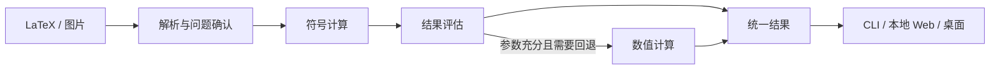
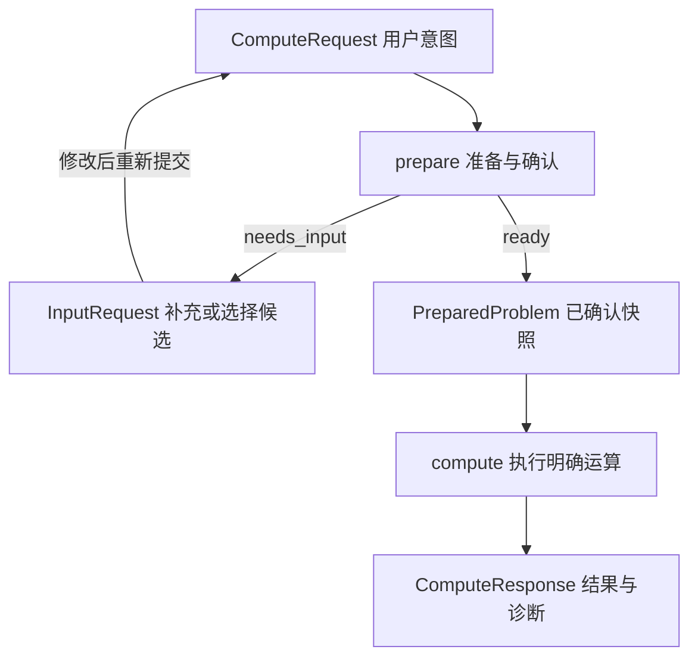

# 项目架构

MathLens 按职责划分 Python 模块与包，共用一条计算链路。模块不必对应独立服务、进程或抽象基类。



## 目录与当前状态

目前已打通 LaTeX 标量算术化简，包含组合校验、严格 JSON 通道及隔离执行。
其他运算、OCR、后台调度和界面尚未实现。下列目录按职责划分。

```text
src/mathlens/
├── __init__.py
├── enums.py                 枚举：运算、状态、定义域等
├── schemas/                 公开数据模型，按类型分组
│   ├── __init__.py          统一导出，保留 mathlens.schemas 导入方式
│   ├── base.py              数学表示、版本常量
│   ├── validation.py        独立参数校验问题，避免模型循环依赖
│   ├── inputs.py            公式输入、图片区域与资源
│   ├── operations.py        运算规格及专属参数
│   ├── requests.py          符号假设、请求偏好、请求与问题快照
│   ├── diagnostics.py       诊断、补充项与确认候选
│   ├── preparation.py       准备响应
│   ├── results.py           数学答案、条件、近似、步骤和计算响应
│   └── tasks.py             预算、能力与 worker 协议
├── application.py           准备、计算、一站式调用
├── preflight.py             父进程与 worker 共用的轻量检查及错误转换
├── pipeline.py              worker 内的准备与化简，复用解析上下文
├── control.py               与执行后端无关的取消和进度控制
├── execution.py             worker 执行、取消和进度接口
├── codec.py                 JSON 编解码与边界校验接口
├── parsing/
│   ├── normalize.py         公式包装清理与修改记录
│   └── latex.py             解析、结构能力检查与原式条件提取
└── solving/
    ├── symbolic.py          当前实现符号化简
    └── serialization.py     数学对象转公开结果
```

CLI、媒体管理、OCR、后台任务和展示层的空接口已移除，实际开发时再定义。
Web、桌面、数值后端和步骤生成器也尚未建立实现模块。数学模型覆盖后续运算，
图片输入形状继续保留，实际启用能力以 get_capabilities 为准。

## 职责与依赖

| 职责 | 内容 | 边界 |
|---|---|---|
| 输入与解析 | OCR 候选、LaTeX 转换、运算意图与参数校验、预览 | 保留原始输入；歧义需要修正或确认 |
| 应用编排 | 准备问题、调用计算、决定回退、控制执行预算 | 入口共用此流程，不各写一套求解逻辑 |
| 计算 | 符号/数值计算、结果分类、校验、步骤与数学内容转换 | 不读用户文件、不调用 OCR、不操作界面 |
| 展示 | 输入编辑、确认、格式选择与排版 | 只展示公开结果，不补算答案或步骤 |
| 共享模型 | 请求、问题描述、结果与诊断 | 可序列化，不依赖第三方数学对象或界面 |

入口调用应用层，应用层组合解析、计算与执行能力；这些模块依赖共享模型，不反向依赖入口。第三方库的对象和调用规则封装在解析、计算内部。

共享模型内部按类型单向引用；业务模块使用 `mathlens.schemas` 统一入口。
模型子模块直接导入其他子模块中的具体类型，不能反向从统一入口导入。
模型不得导入 application、execution、pipeline、preflight 或第三方数学/界面库。

### 校验职责

- 输入、Spec、符号声明、偏好和执行选项各自提供 validate()，返回相对自身的
  ValidationIssue；ComputeRequest 组合这些问题并检查请求内的关系。
- preflight 校验请求和执行选项，再检查跨模型容量限制；application 与 worker
  分发共用这些函数。预检不执行解析、数学计算或进程操作。
- 容量是运行时策略，例如四阶求导本身合法，但可以超过当前配置的阶数上限。
  输入输出字节数、请求精度、阶数和总时限的检查已接入；图片像素和步骤上限
  仍待对应功能实现，配置字段存在不等于该能力已经启用。
- control.py 仅定义运行时令牌与回调。应用不为引用这些类型而加载
  进程后端；execution.py 保留旧控制类型的重导出，便于现有调用继续使用。

### 保持简单

沿用现有模块和统一模型入口，不引入服务注册表、通用流程引擎或额外工厂层。
执行配置、能力与任务数据继续集中在 schemas/tasks.py；容量策略是 preflight
的内部函数。只有真实出现独立职责或重复逻辑时才新增模块或抽象。

## 核心流程



- `run` 串联准备与计算；未就绪返回 PreparationResponse，就绪后返回
  ComputeResponse，两者通过顶层 kind 区分。
- 应用入口只做轻量预检，随后提交单个任务；worker 延迟导入 pipeline，再加载
  解析与数学依赖。pipeline 不调用公共入口，避免递归创建进程。独立 compute
  可重新解析，run 则复用内部上下文；SymPy 对象始终不跨公开边界。
- 模块依赖为 `application → execution → pipeline`；application 和 pipeline
  都可以依赖 preflight。execution、pipeline、preflight 均不得导入 application。
  延迟导入只控制加载时机，不作为允许循环依赖的理由。
- 图片识别接入后，确认的公式经 LatexInput 进入同一链路；计算本身不读取图片。
- execution 负责单次任务监督；运行时控制对象与可序列化的数学请求、执行选项分开。
- codec 在边界恢复和校验模型；solving/serialization 将后端数学对象转为公开
  模型，与 JSON 编解码是不同职责。当前结果可以直接读取 latex 或交给 codec 编码。

## 必须保持的边界

- 公开结果及所有嵌套字段不持有 SymPy 对象。计算侧完成数学内容转换，展示侧只组织格式。
- 准备与计算分开。准备也可能耗时、失败或需要确认，界面不假设其执行位置；修改输入后须重新准备。
- 符号优先，保留定义域、条件和原式约束。未求出、无解、发散、部分解与执行失败分别表达；近似值说明精度和计算范围。
- 数值回退需要适用的问题与充分参数，找到一个根不代表找到全部解，不定积分不能用单个数值代替。
- 长时间解析、求解与校验必须可超时、取消和回收资源；具体执行机制可替换。
- 图片识别、求解、步骤与排版支持本地运行，各入口复用同一核心。

数学核心的数据模型、模块接口、JSON 协议及状态规则见[接口契约](interfaces.md)。
各模型的存放位置和依赖关系见[模型组织说明](schemas.md)。
当前只交付显式化简切片；模型覆盖的能力不等于已启用能力。
当前开发顺序和验收用例见[S1 实施计划](implement-s1.md)，项目目标和进度见 [README](../README.md)。
