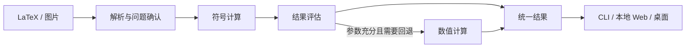

# 项目架构

MathLens 按职责划分 Python 模块与包，共用一条计算链路。模块不必对应独立服务、进程或抽象基类。

## 职责与依赖

| 职责 | 内容 | 边界 |
|---|---|---|
| 输入与解析 | OCR 候选、LaTeX 转换、运算意图与参数校验、预览 | 保留原始输入；歧义需要修正或确认 |
| 应用编排 | 准备问题、调用计算、决定回退、控制执行预算 | 入口共用此流程，不各写一套求解逻辑 |
| 计算 | 符号/数值计算、结果分类、校验、步骤与数学内容转换 | 不读用户文件、不调用 OCR、不操作界面 |
| 展示 | 输入编辑、确认、格式选择与排版 | 只展示公开结果，不补算答案或步骤 |
| 共享模型 | 请求、问题描述、结果与诊断 | 可序列化，不依赖第三方数学对象或界面 |

入口调用应用层，应用层组合解析、计算与执行能力；这些模块依赖共享模型，不反向依赖入口。第三方库的对象和调用规则封装在解析、计算内部。

## 必须保持的边界

- 公开结果及所有嵌套字段不持有 SymPy 对象。计算侧完成数学内容转换，展示侧只组织格式。
- 准备与计算分开。准备也可能耗时、失败或需要确认，界面不假设其执行位置；修改输入后须重新准备。
- 符号优先，保留定义域、条件和原式约束。未求出、无解、发散、部分解与执行失败分别表达；近似值说明精度和计算范围。
- 数值回退需要适用的问题与充分参数，找到一个根不代表找到全部解，不定积分不能用单个数值代替。
- 长时间解析、求解与校验必须可超时、取消和回收资源；具体执行机制可替换。
- 图片识别、求解、步骤与排版支持本地运行，各入口复用同一核心。

当前实现范围、接口细节和具体做法见[实现说明](implementation-s1.md)，项目目标和进度见 [README](../README.md)。
